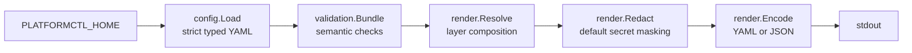

# Architecture

## Purpose and boundaries

`platformctl` is a configuration control plane for infrastructure operators.
It turns a private, layered directory of YAML documents into a validated,
deterministic environment model. The rendered model is deliberately neutral so
that an explicit downstream adapter can consume it without coupling
`platformctl` to a provisioner.

In scope:

- portable operator configuration-home discovery;
- safe scaffolding of managed files and directories;
- strict YAML loading into typed documents;
- semantic and cross-document validation;
- layered, immutable configuration composition;
- deterministic YAML/JSON rendering and inline-secret redaction;
- embedded public JSON Schemas.

Out of scope in the current foundation:

- remote APIs, repository cloning, and process orchestration;
- Terraform, Ansible, Packer, `govc`, Vagrant, or Docker lifecycle as product
  targets;
- credential-reference resolution;
- catalog ownership and service discovery;
- automatic migration or synchronization of consumer repositories.

See [Ecosystem and integrations](ecosystem.md) for the repository boundaries.

## Runtime pipeline



`validate` stops after the validation stage. `render` runs the complete path;
`render.Resolve` also calls validation so package consumers cannot accidentally
resolve an invalid bundle. Any failure prevents a rendered document.

### 1. Configuration-home resolution

[`internal/platformhome`](../internal/platformhome/) uses Go's
`os.UserConfigDir` unless `PLATFORMCTL_HOME` supplies an absolute override.
This keeps operator data independent from the source checkout and portable
across Linux, macOS, and Windows.

### 2. Scaffolding

[`internal/config/scaffold.go`](../internal/config/scaffold.go) owns the exact
`defaults.yaml` and `environment.yaml` templates. Initialization is idempotent
only while a managed file matches its scaffold. Divergent content is preserved
unless `--force` is explicit, and forcing replaces only that managed file.

On POSIX, the scaffold applies `0700` to directories and `0600` to files. It
does not create profiles, services, or hosts.

### 3. Strict loading

[`internal/config/load.go`](../internal/config/load.go) decodes YAML with
`KnownFields(true)` into the types in
[`internal/config/types.go`](../internal/config/types.go). It rejects unknown
structural fields and multiple YAML documents. The loader also enforces:

- valid requested environment identifiers;
- `environment.yaml` metadata matching the requested environment;
- profile/service/host metadata matching each `.yaml` filename;
- deterministic filename traversal.

Only direct `.yaml` children of `profiles/`, `services/`, and `hosts/` are
loaded. The free-form extension point is `spec.values`; structural fields
remain typed and strict.

### 4. Semantic validation

[`internal/validation`](../internal/validation/) checks headers, identifiers,
credentials, profile inheritance, ports, CIDRs, and every cross-document
reference. Independent semantic problems are collected and lexically sorted in
one error. Loading errors occur earlier and cannot be aggregated with semantic
errors.

The validator does not contact the network, inspect referenced files, or read
referenced environment variables.

### 5. Immutable merge

[`internal/merge.Maps`](../internal/merge/merge.go) recursively copies and
merges `map[string]any` values. Nested maps merge key by key; scalars, lists,
and `nil` replace the earlier value. Inputs are never mutated.

For each host, [`internal/render`](../internal/render/) applies:

```text
defaults
  -> environment
  -> profile ancestors (root first)
  -> selected profile
  -> attached services (declared order)
  -> host
```

Credentials use shallow key replacement rather than recursive field merge. A
later credential of the same name replaces the complete `SecretRef`.

### 6. Reference resolution

Service ports may declare `source_hosts`. Rendering replaces those names with
the referenced hosts' CIDR addresses, removes duplicate addresses, and sorts
the result. Host output itself is sorted by host name. Declared service order
is preserved because it affects layer precedence.

### 7. Redaction and encoding

Inline credential values are copied and replaced with `<redacted>` by default.
Environment-variable and file references remain visible because they contain a
location/name, not the referenced secret. `--reveal-secrets` skips redaction.

Encoding supports YAML and indented JSON. The CLI writes encoded bytes to
standard output and does not create an output file itself.

## Component map

| Component | Responsibility | Must not own |
| --- | --- | --- |
| `cmd/platformctl` | Process startup, error printing, exit `1` on error (`2` on a shared-root usage error). | Command behavior or domain logic. |
| `internal/cli` | Cobra commands, flags, and terminal I/O. | Parsing/merge implementations. |
| `internal/platformhome` | Cross-platform configuration-root policy. | Configuration content. |
| `internal/config` | Types, strict loading, and scaffolding. | Semantic reference resolution. |
| `internal/validation` | Semantic and cross-document rules. | File/network side effects. |
| `internal/merge` | Pure recursive map merge. | Domain-specific precedence. |
| `internal/render` | Precedence, source resolution, redaction, encoding. | Infrastructure execution. |
| `internal/schema` | Access to embedded schemas. | Runtime parsing/validation behavior. |
| `schemas/` | Public versioned JSON Schemas embedded in the binary. | Operator configuration values. |
| `internal/sharedroot` | Shared-root commands: root and name rules, the no-follow tree with atomic no-clobber publish, `shared-root.yaml` and shell-file parsers, `bootstrap-config`, `credential`, `doctor`. | The YAML model; consumer loaders; deleting or rewriting files. |

## Shared-root commands

`bootstrap-config`, `credential` and `doctor` do not use the YAML pipeline
above. They implement the platform-catalog
[provision shared root standard](https://github.com/ednillibanio/platform-catalog/blob/main/docs/standards/provision-shared-root-standard.md) in `internal/sharedroot`:

- `root.go`, `names.go`: the root (`--config-dir`,
  `ASSEMBLEIARR_CONFIG_DIR`, `~/.config/assembleiarr`) and the name
  patterns, catalog environments and identity table mirrored from the
  catalog, so no path leaves `<root>/<env>/`.
- `tree_unix.go`: every access goes through directory file descriptors with
  `O_NOFOLLOW`, so a symbolic link inside the tree is refused. A new file is
  written under a temporary name with its final mode and published with
  `link`, which fails when the name exists; a directory (the automation key
  pair) is published with a no-replace rename (`renameat2` on Linux,
  `renamex_np` on macOS). Nothing is ever overwritten or deleted.
  `tree_other.go` returns "not supported" on other systems.
- `declaration.go`, `shellfile.go`: strict parsers of `shared-root.yaml`
  (version 1) and of `vars.sh`/`hosts/<consumer>.sh` (the consumer loaders'
  literal-assignment grammar, including the unquoted `~` rule).
- `bootstrap.go`, `keys.go`, `credential.go`, `doctor.go`: the commands.
  Each validates every argument before it writes anything; `doctor` only
  reads.

## Configuration and rendered models

The input tree contains five document kinds:

```text
Defaults        one per configuration home
Environment     one per environment
Profile         zero or more reusable inheritance layers
Service         zero or more reusable values/credentials/ports
Host            zero or more concrete resolved outputs
```

The output is one `RenderedEnvironment` containing sorted `RenderedHost`
objects. Each host includes its identity, addresses, selected profile/services,
effective values/credentials, and resolved service ports.

The [Configuration reference](configuration.md) defines both models and the
worked merge result. The schemas under
[`schemas/v1alpha1/`](../schemas/v1alpha1/) provide external tooling contracts;
the CLI itself validates through Go parsing and semantic validation rather than
executing JSON Schema validation.

## Security model

- The operator configuration home is external to Git.
- Scaffolded POSIX paths are private by default.
- `env` and `file` references are never dereferenced.
- Inline `value` credentials are redacted unless disclosure is explicit.
- Redaction is immutable: it returns copied credential maps without changing
  the resolved input.
- Redirected render permissions, downstream credential resolution, and
  generated-artifact cleanup belong to the caller/consumer.

The model reduces accidental disclosure but does not encrypt configuration at
rest, manage a secrets backend, or prevent an authorized caller from using
`--reveal-secrets`.

## Validation labs versus controller integration

`vagrant/` and `container/` are disposable development labs. Both mount this
checkout as source and keep toolchains, caches, binaries, status, and renders
outside it. They validate only the committed example and do not receive private
operator data.

The live mount in [Vagrant controller integration](vagrant-controller-integration.md)
is a different pattern: an external service/automation controller mounts the
host's actual `PLATFORMCTL_HOME`. The host remains authoritative, generated
artifacts stay outside the mount, and the integration is limited to Vagrant
`synced_folder`; there is no equivalent container consumer mount today.

## Extension principles

Future integration should preserve these boundaries:

1. keep the rendered model independent of a specific provisioner;
2. implement consumer mappings as explicit, testable adapters;
3. validate before producing partial consumer state;
4. resolve credentials only in the consumer that owns their representation;
5. offer read-only preview/check paths before remote mutation;
6. avoid writing generated or secret data into `PLATFORMCTL_HOME` or Git;
7. evolve public schemas through explicit API versions.
