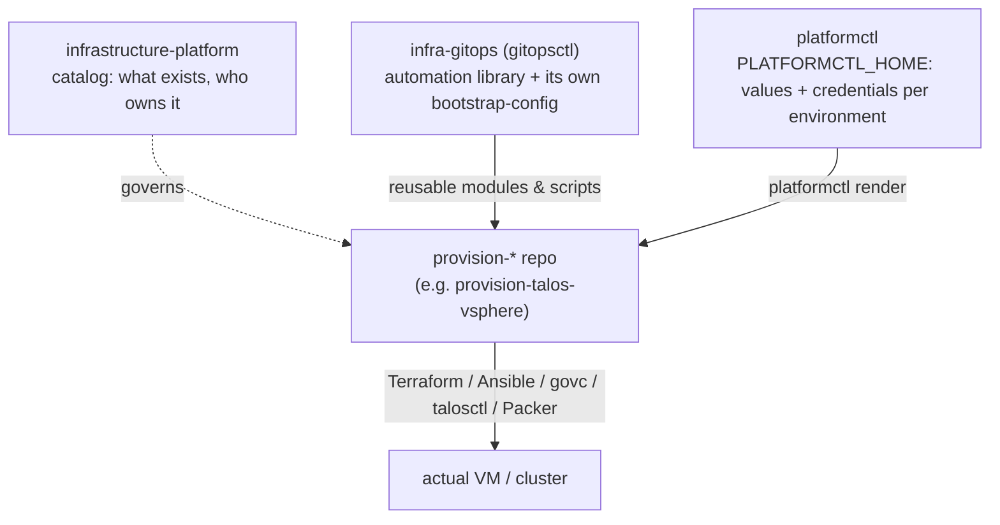

# Ecosystem

platformctl is one piece of a larger, multi-repository automation
ecosystem. This page explains what each piece owns, in what phase it acts,
and how they hand off to each other. It intentionally does not document
the internals of the other repositories — see their own documentation for
that.

## The pieces

| Repository | Role | Holds real values? | Provisions anything? |
| --- | --- | --- | --- |
| `infrastructure-platform` | Public catalog: what services/environments exist, who owns them, cross-repo standards | No — governance metadata only | No |
| `infra-gitops` (`gitopsctl`) | Reusable automation library (Packer/Ansible/Terraform modules, shared scripts) + its own scoped operator config | Only for its own operation (vSphere connection, git identity, an env-scoped SSH key) | No — it's a library other repos call into |
| `platformctl` | Central, per-environment tree of values and credential references/values, private to the operator | Yes — this is its whole purpose | No, deliberately never |
| `provision-*` (e.g. `provision-talos-vsphere`, `provision-glpi`) | Concrete provisioning project for one workload/service | Yes — its own host/topology values, today often duplicated per repo | Yes — this is where Terraform/Ansible/govc/talosctl/Packer actually run |

## Phases

1. **`infrastructure-platform`** answers "does this service exist, who owns
   it, which repo implements it" before any work starts. It is consulted,
   not executed.
2. **`infra-gitops`** provides the reusable building blocks (Packer image
   modules, shared Ansible roles, shared Terraform modules, helper
   scripts) that a `provision-*` repo assembles into a real provisioning
   flow. Its own `gitopsctl bootstrap-config` only manages *its own*
   operator config (vSphere connection, git identity, an env-scoped SSH
   key) — not the values for any downstream service or VM.
3. **`platformctl`** is where an operator privately defines, per
   environment, what hosts/services/profiles exist and what values and
   credentials apply to each — see [Usage](usage.md) for how. It never
   invokes Terraform, Ansible, Packer, govc, or talosctl itself.
   `platformctl render --env <env>` is the hand-off point: a deterministic
   YAML/JSON document any downstream tool can consume.
4. **A `provision-*` repo** is where actual provisioning happens. It reads
   `platformctl render`'s output for the values/credentials it needs (host
   addresses, per-service configuration, credential references), reuses
   `infra-gitops` modules for the mechanics, and runs Terraform/Ansible/
   govc/talosctl/Packer to create and configure the real VM or cluster.

## Why platformctl exists as a separate piece

Today, each `provision-*` repo tends to maintain its own local
`overlays/base/scripts/vars.sh` + `overlays/<env>/scripts/vars.sh` tree —
each one reinventing the same two-level (base + per-environment) variable
pattern independently, with no reuse between repos. platformctl
generalizes that into one central, layered model — defaults → environment
→ profile → service → host — so multiple `provision-*` repos can consume
the same source of truth instead of each keeping its own redundant copy.
Because its render output is plain structured YAML/JSON rather than a
tool-specific format, any consumer (a Terraform data source, an Ansible
dynamic inventory script, a shell script piping through `yq`/`jq`) can read
it without platformctl needing to know about that tool.

## What platformctl is not

- Not a provisioner: it never calls Terraform, Ansible, Packer, govc, or
  talosctl.
- Not the catalog: it doesn't track what services exist across the
  platform or who owns them — that's `infrastructure-platform`.
- Not the automation library: it has no Packer/Ansible/Terraform modules
  of its own — that's `infra-gitops`.

See also: [Usage](usage.md) for how to actually author configuration, and
[Configuration reference](configuration.md) for the layer-resolution
mechanics and directory structure.
