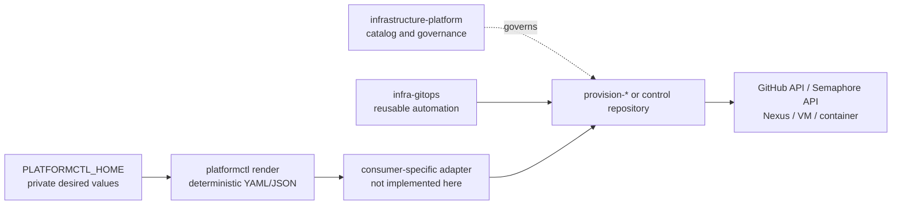

# Ecosystem and integrations

`platformctl` is the operator-side configuration control plane in a
multi-repository automation ecosystem. This document defines ownership,
handoffs, and current integration status. It does not replace the authoritative
documentation of the related repositories.

## Current integration status

The stable handoff available today is:

```text
PLATFORMCTL_HOME -> platformctl validate -> platformctl render -> YAML or JSON
```

The rendered document is ready for downstream consumption, but this repository
does not currently ship adapters for `provision-platform-environments`,
`provision-semaphoreui`, `provision-nexus3`, `infra-gitops`, or another
`provision-*` repository. Those repositories also do not currently invoke
`platformctl` in their committed workflows.

Therefore:

- the repository relationships below are real ownership and data-contract
  relationships;
- automatic transfer from a render into consumer manifests, inventories, API
  calls, or secret directories is **planned**, not implemented;
- operators must not assume that editing `PLATFORMCTL_HOME` changes GitHub,
  SemaphoreUI, Nexus, a VM, or a container.

## Dependency and link boundary

`platformctl` does not declare a source, build, or runtime dependency on any
of the repositories in this guide. In particular, it has no Git submodules,
does not clone repositories, invoke their CLIs, or call their APIs. Its Go
module dependencies are limited to Cobra and the YAML parser; the container
and Vagrant labs are development-only dependencies, not integration adapters.

The repository links below deliberately point to the related repositories'
`lab` branches, where their pre-promotion integration contracts are reviewed.
On 2026-08-28, each linked repository, branch, and referenced document was
verified through GitHub. The related repositories use `main` as their default
branch, so use the linked `lab` material when evaluating a change that will be
integrated through `lab`; do not infer a runtime dependency from those links.

For a new adapter, start by treating the rendered YAML or JSON and the schemas
in [`schemas/v1alpha1/`](../schemas/v1alpha1/) as the only `platformctl`
contract. Open a scoped issue in the selected consumer repository, define and
test the field and credential mapping there, then deliver the adapter through
that repository's normal review flow. No repository currently performs this
step automatically.

## Repository responsibilities

| Repository | Authoritative responsibility | Real values? | Executes changes? | Relationship to `platformctl` |
| --- | --- | --- | --- | --- |
| `infrastructure-platform` | Public catalog and governance: what exists, ownership, and cross-repository standards. | No operational values. | No. | Conceptual catalog; no current runtime integration. |
| [`al-rr/infra-gitops`](https://github.com/al-rr/infra-gitops) | Reusable Bash, Ansible, Terraform, Packer, and container automation modules. | Only its own scoped operator configuration. | Library content is executed by consumers. | Future provisioners can combine its modules with a `platformctl` render. |
| [`platformctl`](https://github.com/ednillibanio/platformctl) | Private layered values and credential references/values per environment. | Yes, by design. | No infrastructure or remote APIs. | Produces the neutral YAML/JSON handoff. |
| [`al-rr/provision-platform-environments`](https://github.com/al-rr/provision-platform-environments) | Declarative GitHub Environment variables and secret names, reconciled through `platform-environments-ctl`. | Non-secret values in manifests; secret values arrive from local files at apply time. | Yes, against the GitHub API after operator approval. | Candidate consumer for artifact/Nexus values and credential references; adapter not implemented. |
| [`al-rr/provision-semaphoreui`](https://github.com/al-rr/provision-semaphoreui) | SemaphoreUI container lifecycle and declarative Project/Repository/Inventory/Environment/Template reconciliation. | Secret-free manifests plus operator-supplied secret files. | Yes, against Docker and the Semaphore API. | Candidate consumer for host, Nexus, and deployment values; adapter not implemented. |
| [`al-rr/provision-nexus3`](https://github.com/al-rr/provision-nexus3) | Nexus3 lifecycle, repository structure, roles, and technical accounts through Ansible and SemaphoreUI workflows. | Environment inventory and external credentials. | Yes, against Nexus3/Docker. | Defines authoritative Nexus provisioning contracts that a future `platformctl` service model can describe for consumers. |
| Other `provision-*` repositories | Concrete lifecycle for one workload or platform component. | Usually yes, scoped to that consumer. | Yes. | May consume selected hosts/services from rendered output through an explicit adapter. |

## Intended flow



The adapter is intentionally explicit. A generic render cannot decide, for
example, whether a credential reference should become a GitHub Environment
secret file, a Semaphore `env` secret, a Semaphore Ansible-variable secret, or
an Ansible lookup. That mapping belongs to the consuming repository and must be
documented and validated there.

## Cross-repository contracts

### `infra-gitops`

[`infra-gitops`](https://github.com/al-rr/infra-gitops) is the reusable
automation library. Its `gitopsctl bootstrap-config` manages the library's own
configuration tree under `~/.config/infra-gitops`; that tree is separate from
`PLATFORMCTL_HOME` and should not be presented as an alias or replacement.

Authoritative starting points:

- [infra-gitops README](https://github.com/al-rr/infra-gitops/blob/lab/README.md)
- [Ansible external configuration](https://github.com/al-rr/infra-gitops/blob/lab/docs/en/ansible-external-configuration.md)
- [Project-local Ansible environment](https://github.com/al-rr/infra-gitops/blob/lab/docs/en/ansible-project-environment.md)

A future provisioner can read a `platformctl` render for desired values while
using `infra-gitops` modules for execution mechanics. Neither repository needs
to absorb the other's configuration ownership.

### `provision-platform-environments`

[`provision-platform-environments`](https://github.com/al-rr/provision-platform-environments)
owns GitHub Environments such as `artifact-lab`. Its committed manifests carry
non-secret values including Nexus endpoints/repository names and declare secret
names. At apply time, same-named local files provide secret values.

Authoritative starting points:

- [Repository README](https://github.com/al-rr/provision-platform-environments/blob/lab/README.md)
- [`ArtifactEnvironmentManifest` reference](https://github.com/al-rr/provision-platform-environments/blob/lab/docs/reference/manifest.md)
- [Nexus technical-account contract](https://github.com/al-rr/provision-platform-environments/blob/lab/docs/nexus-account-contract.md)

A future adapter may select non-secret Nexus values from a rendered service and
materialize the consumer manifest. Credential resolution must remain a separate
apply-time operation: `platformctl` itself never opens `env` or `file`
references, and the consumer requires raw, mode-`0600`, same-named files.

### `provision-semaphoreui`

[`provision-semaphoreui`](https://github.com/al-rr/provision-semaphoreui)
owns both the SemaphoreUI container and declarative API reconciliation through
`semaphoreui-ctl`. Its manifests distinguish process-environment secrets from
Ansible-variable secrets; they are not interchangeable.

Authoritative starting points:

- [Repository README](https://github.com/al-rr/provision-semaphoreui/blob/lab/README.md)
- [`semaphoreui-ctl` CLI reference](https://github.com/al-rr/provision-semaphoreui/blob/lab/docs/cli-reference.md)
- [Java projects lab runbook](https://github.com/al-rr/provision-semaphoreui/blob/lab/docs/lab-java-projects-runbook.md)

A future adapter must map rendered host/service data into the correct Inventory
and Environment fields and map each credential to the secret type expected by
the consumed playbook. A direct field-name copy is not a sufficient contract.

### `provision-nexus3`

[`provision-nexus3`](https://github.com/al-rr/provision-nexus3) owns real Nexus3
deployment, repository configuration, roles, and technical accounts. It
consumes the `assembleiarr.services.nexus3` Ansible Collection from
`infra-gitops`.

Authoritative starting points:

- [Repository README](https://github.com/al-rr/provision-nexus3/blob/lab/README.md)
- [Ansible configuration reference](https://github.com/al-rr/provision-nexus3/blob/lab/ansible/README.md)
- [Lab provisioning runbook](https://github.com/al-rr/provision-nexus3/blob/lab/docs/lab-provisioning-runbook.md)

The Nexus account contract deliberately separates the CI account used by
GitHub workflows from the deployment account used by SemaphoreUI. A future
`platformctl` model or adapter must preserve that separation and must never
collapse both into an administrative credential.

## Example future handoff

The following is an architectural example, not an implemented command:

```text
platformctl Service "nexus"
  non-secret values: URL, OCI registry, Maven/raw repository names
  credential refs:  CI account, deployment account (separate)

platformctl Host "application-dev"
  addresses: deployment target CIDRs

                    render --format json
                              |
             +----------------+----------------+
             |                                 |
  platform-environments adapter      semaphoreui adapter
  GitHub variables + CI secret       Inventory/Environment + deploy secret
```

Each adapter should:

1. validate the selected render and expected keys;
2. fail closed on missing or ambiguous values;
3. resolve only the credential references it owns;
4. write consumer-specific temporary files with restrictive permissions;
5. support a read-only check/diff/dry-run path where the consumer provides one;
6. avoid committing generated manifests or secret material;
7. document the exact mapping and cleanup behavior in the consumer repository.

## What `platformctl` is not

- It is not the public catalog or ownership registry.
- It is not the `infra-gitops` reusable automation library.
- It is not a GitHub Environment, SemaphoreUI, Nexus, Terraform, or Ansible
  client.
- It does not automatically synchronize other repositories.
- It does not resolve referenced credentials or decide consumer secret types.
- Its disposable Vagrant/container labs validate this repository only; they are
  not managed infrastructure environments.

For the render model itself, continue with the
[Configuration reference](configuration.md). For internal boundaries, see
[Architecture](architecture.md).
